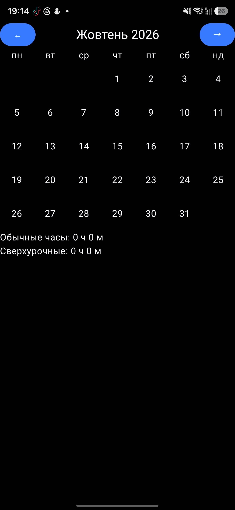
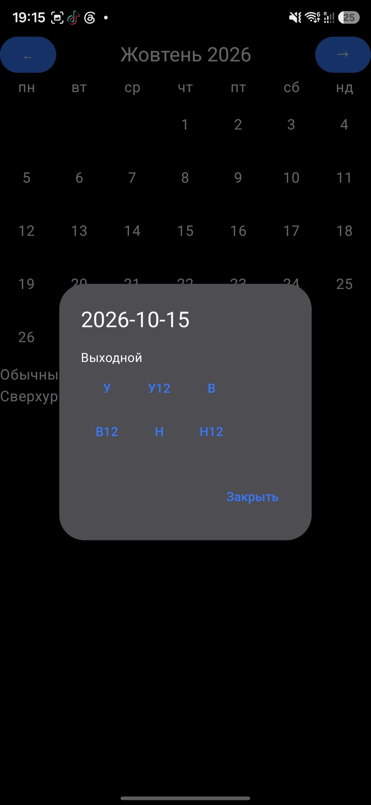

# TimeManagement - Shift Hours Tracker

An Android app for tracking working hours on a rotating shift schedule. I built it to solve a real problem from my own job: shifts change often, include unpaid breaks, and some of them carry fixed overtime, so counting monthly hours by hand was tedious and error-prone.

You mark each worked day on a monthly calendar, and the app calculates regular hours and overtime for the month automatically.


<p>
  
  
  
</p>


## Features

- Monthly calendar grid (Monday-first) with month navigation
- Tap a day to add, replace or delete a shift
- Color-coded cells: regular shifts and 12-hour shifts are visually distinct
- Monthly totals of regular hours and overtime, updated live as shifts change
- Offline, all data stored locally on the device

## Shift model

| Shift | Time | Regular | Overtime   |
|---|---|---|------------|
| Morning | 05:30–14:00 | 7 h 45 min | -          |
| Evening | 14:30–23:00 | 7 h 45 min | -          |
| Night | 23:00–05:30 | 5 h 55 min | -          |
| Morning, 12 h | 05:30–17:30 | 7 h 45 min | 3 h 20 min |
| Evening, 12 h | 14:30–02:30 | 7 h 45 min | 3 h 20 min |
| Night, 12 h | 17:30–05:30 | 5 h 55 min | 5 h 10 min |

Paid time already excludes unpaid breaks. Shifts that cross midnight follow a fixed dating rule: night shifts are recorded on the day they end, while the 14:30–02:30 shift is recorded on the day it starts. As a result, each calendar date holds at most one shift, which is enforced by a unique index in the database.

## Tech stack

- **Kotlin**
- **Jetpack Compose** (Material 3) for the UI
- **Room** with **KSP** for local persistence, with schema export enabled for future migrations
- **Kotlin Coroutines & Flow** (`StateFlow`, `flatMapLatest`, `map`, `stateIn`)
- **AndroidX ViewModel** with lifecycle-aware state collection
- **JUnit** for unit tests
- minSdk 26

## Architecture

The app follows a layered MVVM structure with unidirectional data flow:

```
UI (Compose)  ──events──▶  ViewModel  ──▶  Repository  ──▶  Room (DAO)
     ▲                         │
     └────── StateFlow ◀───────┘
```

- **model/**: domain types (`Shift`, `ShiftType` enum with paid minutes per shift)
- **domain/**: pure business logic (`calculateWorkMinutes`), free of Android dependencies
- **data/**: Room entity, DAO, type converters, database and repository; the entity is mapped to the domain model so the rest of the app doesn't depend on Room
- **ui/**: Compose screens and the `CalendarViewModel`

The ViewModel exposes the current month, the shifts of that month and the monthly totals as `StateFlow`s. Changing the month switches the database query via `flatMapLatest`; any change in the database propagates to the totals and the UI automatically.

## Tests

Unit tests cover the pure logic:

- work-hour calculation for different shift combinations
- calendar grid layout (leading/trailing empty cells for months starting on different weekdays)
- formatting minutes into hours and minutes

Run them with:

```
./gradlew test
```

## Build & run

1. Clone the repository and open it in Android Studio.
2. Run the `app` configuration on an emulator or a device (Android 8.0+).

To build a debug APK: **Build → Generate App Bundles or APKs → Generate APKs**.

## Roadmap

- Early leave from a shift (partial hours)
- Salary calculation
- Additional statistics screens with bottom navigation
- Showing days of neighboring months in the calendar grid

## About

A learning project: my background is in Java and web development, and this is my first real Android app in Kotlin and Jetpack Compose. It solves a real problem for me and my coworkers. The UI is currently in Russian.